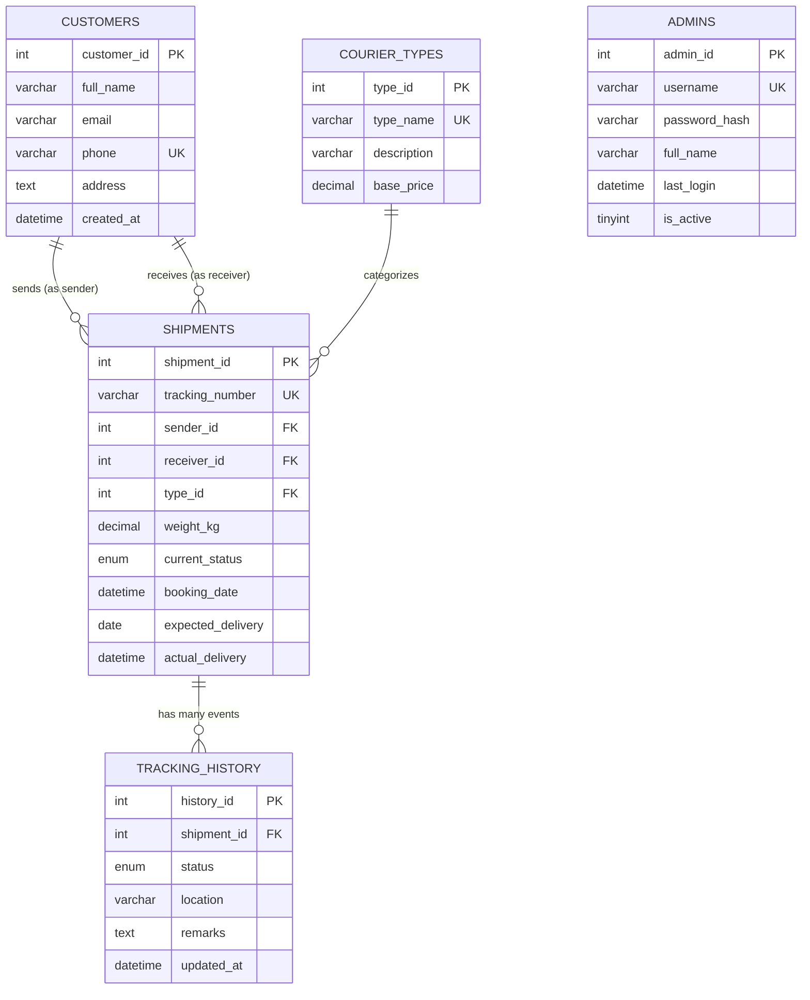

# 📦 CourierTrack — Courier Tracking System

> **RDBMS College Project** | Node.js · Express.js · MySQL 8.0 · Vanilla JS

A fully functional, production-style courier tracking system demonstrating core RDBMS concepts including normalization, foreign keys, views, joins, transactions, and aggregate functions.

---

## 🎯 Project Objective

Build a complete web-based Courier Tracking System that:
- Allows customers to **book shipments** and receive a unique tracking number
- Provides **real-time shipment tracking** through a tracking number lookup
- Gives administrators a **secure dashboard** to manage and update shipments
- Demonstrates advanced **RDBMS concepts** (normalization, views, joins, transactions)

---

## ✨ Features

| Feature | Description |
|---|---|
| 📦 Courier Booking | Book with sender/receiver details, choose courier type, get instant tracking number |
| 🔍 Real-Time Tracking | Full shipment timeline with location, status, and timestamps |
| 🔐 Admin Login | bcrypt-hashed passwords, session-based auth, rate-limited login |
| 📊 Admin Dashboard | Live stats cards, full shipments table, search/filter/pagination |
| ✏️ Status Management | Admins update status + tracking history in a single DB transaction |
| 🗄️ SQL Views | 5 views demonstrating JOINs, GROUP BY, aggregates, and subqueries |
| 📱 Responsive Design | Works on desktop and mobile |

---

## 🛠️ Technology Stack

### Frontend
- HTML5, CSS3 (Vanilla — no frameworks)
- Vanilla JavaScript (ES2020)
- Google Fonts (Inter)

### Backend
- **Node.js** v18+ with **Express.js** v4
- **mysql2/promise** — async MySQL connection pool
- **bcryptjs** — password hashing
- **express-session** — session management
- **express-rate-limit** — brute-force protection
- **dotenv** — environment configuration

### Database
- **MySQL 8.0**
- 5 normalized tables (3NF)
- 5 SQL views
- Foreign key constraints, transactions, indexes

---

## 🏗️ Architecture

```
Browser  ──fetch──▶  Express API  ──sql──▶  MySQL 8.0
   │                     │
   │        Static files served by Express
   └───────────────────────────────────────▶  Frontend HTML/CSS/JS
```

---

## 📁 Folder Structure

```
COURIER TRACKING SYSTEM/
├── frontend/
│   ├── index.html          # Homepage with hero + tracking widget
│   ├── track.html          # Tracking page
│   ├── book.html           # Booking form
│   ├── login.html          # Admin login
│   ├── admin.html          # Admin dashboard
│   ├── css/
│   │   └── style.css       # Global design system
│   └── js/
│       ├── main.js         # Shared utilities
│       ├── track.js        # Tracking logic
│       ├── book.js         # Booking logic
│       ├── login.js        # Login logic
│       └── admin.js        # Dashboard logic
├── backend/
│   ├── server.js           # Express app entry point
│   ├── db.js               # MySQL connection pool
│   ├── routes/
│   │   ├── trackingRoutes.js
│   │   ├── shipmentRoutes.js
│   │   ├── authRoutes.js
│   │   └── dashboardRoutes.js
│   ├── controllers/
│   │   ├── trackingController.js
│   │   ├── shipmentController.js
│   │   ├── authController.js
│   │   ├── dashboardController.js
│   │   └── healthController.js
│   ├── middleware/
│   │   ├── authMiddleware.js
│   │   └── errorMiddleware.js
│   └── scripts/
│       ├── setupDb.js      # Runs schema.sql safely
│       └── createAdmin.js  # Creates admin with hashed password
├── sql/
│   ├── schema.sql          # Full database schema + sample data
│   └── reporting_queries.sql # RDBMS demo queries
├── tests/
│   └── runTests.js         # Automated test suite
├── .env.example            # Environment template
├── .gitignore
├── package.json
└── README.md
```

---

## 🗄️ Database Design

### ER Diagram (Mermaid)



### Normalization

| Normal Form | Satisfied? | Evidence |
|---|---|---|
| 1NF | ✅ | All columns are atomic; no repeating groups |
| 2NF | ✅ | All non-key attributes depend on the full primary key |
| 3NF | ✅ | No transitive dependencies; customer data separated from shipments |

### SQL Views

| View | Purpose | SQL Concepts |
|---|---|---|
| `vw_shipment_details` | Full shipment info | INNER JOIN (3 tables) |
| `vw_active_shipments` | Non-delivered shipments | WHERE filter on view |
| `vw_dashboard_stats` | Count aggregates | COUNT, SUM, conditional aggregation |
| `vw_shipments_by_type` | Revenue by type | GROUP BY, AVG, SUM, LEFT JOIN |
| `vw_latest_tracking` | Most recent event per shipment | Correlated subquery, MAX |

---

## 📋 Prerequisites

- **Node.js** v18 or later → [nodejs.org](https://nodejs.org)
- **MySQL Server 8.0** → [mysql.com/downloads](https://dev.mysql.com/downloads/mysql/)
- **MySQL Workbench** (optional, for running SQL scripts)

---

## ⚙️ Installation & Setup

### Step 1 — Clone / Open the project
```bash
cd "COURIER TRACKING SYSTEM"
```

### Step 2 — Install dependencies
```bash
npm install
```

### Step 3 — Configure environment
```bash
# Copy the template
copy .env.example .env
```
Edit `.env` and set your MySQL root password:
```
DB_HOST=localhost
DB_PORT=3306
DB_USER=root
DB_PASSWORD=your_actual_password
DB_NAME=courier_tracking
PORT=3000
SESSION_SECRET=change_this_to_a_long_random_string
```

### Step 4 — Set up the database
```bash
node backend/scripts/setupDb.js
```
This runs `sql/schema.sql` safely (uses `IF NOT EXISTS` — won't overwrite existing data).

### Step 5 — Create an admin account
```bash
node backend/scripts/createAdmin.js admin YourSecurePassword123 "Admin User"
```
> ⚠️ Choose a strong password. It is hashed with bcrypt before storage.

### Step 6 — Start the application
```bash
npm run dev        # Development (auto-restarts with nodemon)
# or
npm start          # Production
```

### Step 7 — Open in browser
```
http://localhost:3000
```

---

## 🌐 API Documentation

### Public Endpoints

| Method | Path | Description |
|---|---|---|
| `GET` | `/api/health` | Server + DB connectivity check |
| `GET` | `/api/track/:trackingNumber` | Track a shipment by number |
| `POST` | `/api/shipments` | Book a new shipment |

### Protected Endpoints (Admin session required)

| Method | Path | Description |
|---|---|---|
| `GET` | `/api/shipments` | List all shipments (paginated) |
| `GET` | `/api/shipments/:id` | Get single shipment detail |
| `PATCH` | `/api/shipments/:id/status` | Update shipment status |
| `GET` | `/api/dashboard/stats` | Dashboard statistics |
| `POST` | `/api/auth/login` | Admin login |
| `POST` | `/api/auth/logout` | Admin logout |
| `GET` | `/api/auth/me` | Check current session |

### Example: Book a Shipment
```json
POST /api/shipments
{
  "sender_name": "Arjun Sharma",
  "sender_phone": "9876543210",
  "sender_email": "arjun@example.com",
  "sender_address": "12 MG Road, Bangalore",
  "receiver_name": "Priya Patel",
  "receiver_phone": "9876543211",
  "receiver_address": "45 Linking Road, Mumbai",
  "weight_kg": 2.5,
  "courier_type": "Express",
  "expected_delivery": "2024-12-15"
}
```

### Example: Update Status (Admin)
```json
PATCH /api/shipments/3/status
{
  "status": "In Transit",
  "location": "Delhi Hub",
  "remarks": "Parcel forwarded to destination city"
}
```

---

## 🧪 Testing

```bash
# Start the server first (in a separate terminal)
npm run dev

# Then run tests
npm test
```

### Test Coverage

| # | Test Case | Type |
|---|---|---|
| 1 | Health check returns 200 | API |
| 2 | Health check reports DB status | API |
| 3 | Valid tracking number returns shipment | Integration |
| 4 | Invalid tracking number returns 404 | API |
| 5 | Too-short input returns 400 | Validation |
| 6 | Missing sender name returns 400 | Validation |
| 7 | Missing weight returns 400 | Validation |
| 8 | Invalid courier type returns 400 | Validation |
| 9 | Valid booking returns 201 + tracking number | Integration |
| 10 | Unique tracking number format verified | Integration |
| 11 | Login with empty credentials returns 400 | Auth |
| 12 | Wrong password returns 401 | Auth |
| 13 | Unauthenticated /me returns 401 | Auth |
| 14 | /api/shipments without auth returns 401 | Authorization |
| 15 | /api/dashboard/stats without auth returns 401 | Authorization |
| 16 | Status PATCH without auth returns 401 | Authorization |
| 17 | Invalid status value rejected | Validation |
| 18 | Non-numeric shipment ID handled | Validation |
| 19-23 | All 5 HTML pages served correctly | Frontend |

---

## 🔐 Security Features

- Passwords hashed with **bcrypt** (12 salt rounds) — never stored in plaintext
- **Parameterized SQL queries** — no SQL injection possible
- **Rate limiting** on login (10 attempts / 15 minutes per IP)
- **Session-based auth** with httpOnly cookies
- **CORS** restricted to same-origin only
- Internal errors never exposed to API clients
- `.env` file excluded from git via `.gitignore`

---

## 🎓 RDBMS Viva Q&A

**Q: What is normalization?**
A: The process of organizing a database to reduce redundancy and dependency. This project uses 3NF: 1NF (atomic values), 2NF (full functional dependency), 3NF (no transitive dependency).

**Q: What is a foreign key?**
A: A column referencing the primary key of another table, enforcing referential integrity. Example: `shipments.sender_id` → `customers.customer_id`.

**Q: What is an SQL view?**
A: A stored query that acts like a virtual table. Example: `vw_shipment_details` joins three tables to show complete shipment info.

**Q: What is a transaction?**
A: A set of SQL operations executed as a single unit. If any step fails, all changes are rolled back. Used in status updates: UPDATE shipment + INSERT tracking_history must both succeed.

**Q: What is the difference between INNER JOIN and LEFT JOIN?**
A: INNER JOIN returns only rows with matches in both tables. LEFT JOIN returns all rows from the left table, with NULLs for unmatched rows on the right.

**Q: How is the tracking number generated uniquely?**
A: The server generates a random `CTS-YEAR-NNNNN` string and checks the database for collisions before inserting, retrying up to 5 times. The `tracking_number` column also has a `UNIQUE` constraint as a database-level safety net.

---

## ✅ Demonstration Checklist (for ma'am)

- [ ] Open `http://localhost:3000` — homepage loads
- [ ] Enter `CTS-2024-00001` in hero search → tracking page shows timeline
- [ ] Open `/book` → fill form → submit → get tracking number
- [ ] Track the newly booked shipment
- [ ] Open `/login` → login with admin credentials
- [ ] Admin dashboard shows stat cards and shipments table
- [ ] Search/filter shipments
- [ ] Click **Update** on a shipment → change status → confirm update
- [ ] Track that shipment again → new event appears in timeline
- [ ] Open MySQL Workbench → run `sql/reporting_queries.sql` → show views, joins, aggregates
- [ ] Run `npm test` → show passing tests

---

## ⚠️ Known Limitations

- No email/SMS notifications
- No payment processing
- No real GPS/map tracking
- Admin accounts managed via CLI (no admin self-registration UI)

---

*Built as an RDBMS college demonstration project. Node.js · Express · MySQL 8.0*
